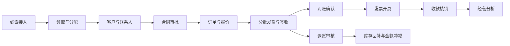

# CRM · 企业销售与经营协同系统

**从一条线索到一笔回款，让销售推进、订单履约与经营分析形成完整闭环。**

北辰 CRM 面向渠道销售、汽车后市场及产品供销场景，将客户经营、合同审批、产品报价、订单发货、对账开票和回款核销集中到同一套系统。销售、运营、财务与管理人员围绕真实业务单据协作，管理者可以从部门、员工、产品和来源等维度查看经营表现。

项目采用 Vue 3 + Spring Boot 3 + MyBatis + MySQL 前后端分离架构，主要业务链路已完成本地接口联调验证，目前持续迭代。

## 业务全景

| 业务域 | 核心能力 |
| --- | --- |
| 工作台与待办 | 实时指标、跨模块待办聚合、SLA 到期分组、日历提醒、个人目标 |
| 线索经营 | 线索建档、公共线索池、领取与分配、批量转移、撞单提醒、转客户 |
| 客户经营 | 客户档案、联系人、跟进记录、团队跟进看板、公共客户池、重复客户合并 |
| 产品与报价 | 产品分类、规格与单位换算、阶梯价格、客户协议价、组合产品、库存查询 |
| 合同与订单 | 合同明细、审批流转、合同订单与备货订单、取价预检、信用与底价提醒 |
| 履约与结算 | 分批发货、签收、退货审核与入库、对账单、开票与红冲、收款与核销 |
| 行政财务 | 费用报销、借款预支、请假申请、统一审批中心 |
| 经营分析 | 销售概况、销售漏斗、客户分析、业绩分析、回款分析、产品分析、来源 ROI |
| 组织与权限 | 多级部门、员工管理与调部门、多角色授权、接口权限、数据范围控制 |
| 目标与个人中心 | 部门季度目标、个人月度目标、批量设置、变更记录、个人资料与密码维护 |

## 连接销售与财务的业务闭环



主要流程已通过本地接口验收，覆盖线索转客户、跨账号合同审批、订单审批、发货签收、对账、开票、核销及反核销。测试也覆盖部分越权请求、重复核销提交和退货驳回理由落库。

## 业务细节

### 销售推进与履约协同

- 产品单位与订单单位之间进行数量换算，库存以销售单位展示。
- 下单时检查信用额度、成交底价和库存情况，返回业务提醒。
- 库存不足与按单排产支持提醒后继续接单，便于销售与生产衔接。
- 发货、退货和签收通过单据关联订单，支持追踪履约过程。

### 财务结算可追溯

- 对账单汇总发货、退货和收款，形成账期快照。
- 核销目标统一为发票，校验客户归属、待收金额与收款余额。
- 核销支持请求编号防重，反核销记录操作人、时间与原因。
- 关键批量写入使用事务，失败时回滚本次操作。

### 权限进入后端执行

- `/api/**` 统一执行登录校验，登录入口单独放行。
- 员工、部门和角色管理接口按操作权限校验。
- 业务模块结合权限码与本人、部门及下级、全公司等数据范围控制访问。
- 请求时读取账号状态与权限，支持停用和授权变更生效。

### 报表从业务单据取数

- 销售分析按实际发货金额统计，并冲减已确认退货。
- 回款分析读取有效核销记录，提供应收、逾期及账龄分布。
- 产品分析关联出入库明细，按真实品类生成趋势。
- 目标完成额通过后端汇总，支持部门季度和个人月度口径。
- 报表支持部门、负责人和时间筛选，以及 Excel 导出。

## 技术架构

| 层次 | 技术 |
| --- | --- |
| 前端 | Vue 3、Composition API、Vue Router 4、Vite 5 |
| 后端 | Java 17、Spring Boot 3.5、Spring MVC |
| 数据访问 | MyBatis 3、Spring JDBC、事务管理 |
| 数据库 | MySQL 8 |
| 接口与认证 | REST API、服务端 Session、权限码与数据范围校验 |
| 部署 | 前端静态资源、后端可执行 JAR、Nginx 反向代理 |

后端按业务模块分包，模块内部组织 Controller、Service、Mapper 和模型。前端以业务页面、接口层、状态管理与共享组合函数组织代码，便于沿着具体功能阅读和扩展。

## 项目结构

```text
CRMproject/
├─ frontend/
│  ├─ src/
│  │  ├─ api/           # 接口封装
│  │  ├─ views/         # 业务页面
│  │  ├─ components/    # 通用组件
│  │  ├─ composables/   # 共享业务逻辑
│  │  ├─ store/         # 状态与数据管理
│  │  └─ router/        # 页面路由
│  └─ package.json
├─ backend/
│  ├─ src/main/java/com/crm/
│  ├─ src/main/resources/
│  └─ pom.xml
├─ database/            # 建表、增量迁移与测试数据脚本
├─ docs/                # 模块接口契约与业务规则
├─ scripts/             # 本地启停脚本
├─ start-dev.bat
└─ stop-dev.bat
```

## 本地运行

环境需要 Java 17、Maven、Node.js 与 npm、MySQL 8。数据库目录包含建表、增量迁移与演示数据脚本，初始化前请阅读 [数据库说明](database/README.md)，按已有数据库版本选择脚本。

后端通过环境变量读取数据库连接信息。

```powershell
$env:CRM_DB_URL = 'jdbc:mysql://127.0.0.1:3306/crm'
$env:CRM_DB_USER = '你的数据库账号'
$env:CRM_DB_PASSWORD = '你的数据库密码'

cd backend
mvn spring-boot:run
```

另开一个终端启动前端。

```powershell
cd frontend
npm install
npm run dev
```

默认前端地址为 `http://localhost:5180`，后端为 `http://127.0.0.1:8080`。开发环境由 Vite 将 `/api` 请求转发到后端。

Windows 可运行根目录 `start-dev.bat` 启动项目，使用 `stop-dev.bat` 停止。启动脚本读取 `CRM_DB_PASSWORD`，未设置时提示输入。本地 Maven 仓库路径配置在 `backend/.mvn/maven.config`，请按实际环境调整。

## 构建与部署

```powershell
# 前端产物位于 frontend/dist
cd frontend
npm run build

# 后端产物位于 backend/target/crm-backend.jar
cd ../backend
mvn package
```

Nginx 转发时需要保留后端的 `/api` 前缀。前后端同机部署可使用以下配置片段。

```nginx
location /api/ {
    proxy_pass http://127.0.0.1:8080;
    proxy_set_header Host $host;
    proxy_set_header X-Real-IP $remote_addr;
    proxy_set_header X-Forwarded-For $proxy_add_x_forwarded_for;
}
```

部署前设置数据库环境变量、执行适用的数据库迁移，并为业务账号设置独立密码。生产环境应结合 HTTPS、数据库访问限制及备份策略完成部署配置。

## 开发状态

当前版本适合业务流程演示、内部测试和持续二次开发。部分测试脚本会生成演示单据，执行前请确认目标数据库。

历史客户状态流转、完整线索阶段历史等指标仍依赖后续数据积累。回款账龄目前按开票日加客户账期计算。已有验证以本地接口联调和构建检查为主，完整浏览器回归、并发测试与部署环境验收仍需持续完善。

接口与业务规则可在 [docs](docs) 中按模块查阅。
